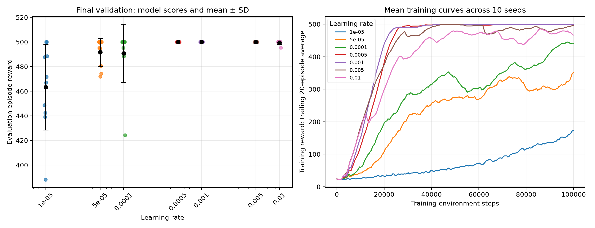

# RL Toy Project

A toy reinforcement learning project for learning local development, Git, training, evaluation, and running experiments on NUS HPC.

## CartPole learning-rate experiment

Seven learning rates, ten training seeds each, and 100,000 requested training steps per run.

[Experiment details and numerical results](reports/cartpole-lr-sweep/README.md)