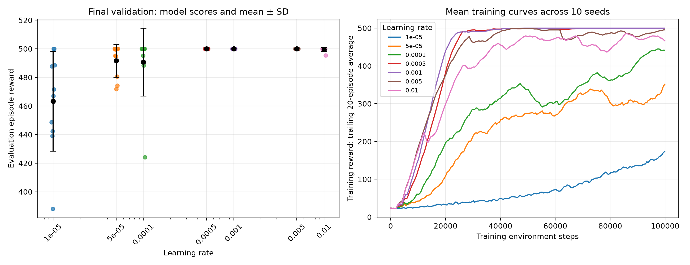

# CartPole PPO learning-rate experiment

Comparison of seven constant learning rates, with ten independent training seeds per candidate.

## Experiment settings

| Setting | Value |
|---|---|
| Environment | CartPole-v1 |
| Algorithm | PPO |
| Learning rates | 0.00001, 0.00005, 0.0001, 0.0005, 0.001, 0.005, 0.01 |
| Training seeds | 42–51 |
| Requested training steps | 100,000 per run |
| Validation episodes | 20 per trained model |
| Validation seed | 1000 |
| Training device | CPU |

Other PPO settings were held fixed.

## Reading the figure

The left panel shows each trained model’s mean validation reward. Black markers show the mean and sample standard deviation across the ten training seeds. These error bars describe variability across training runs; they are not confidence intervals.

The right panel shows training rewards smoothed over the most recent 20 episodes, interpolated onto a common step grid, and averaged across ten training runs.

Validation scores are used for comparing learning rates. They are not an independent final test of the selected setting.

## Numerical results

- [Summary by learning rate](summary.csv)
- [Individual model scores, actual training steps, and code versions](run_scores.csv)